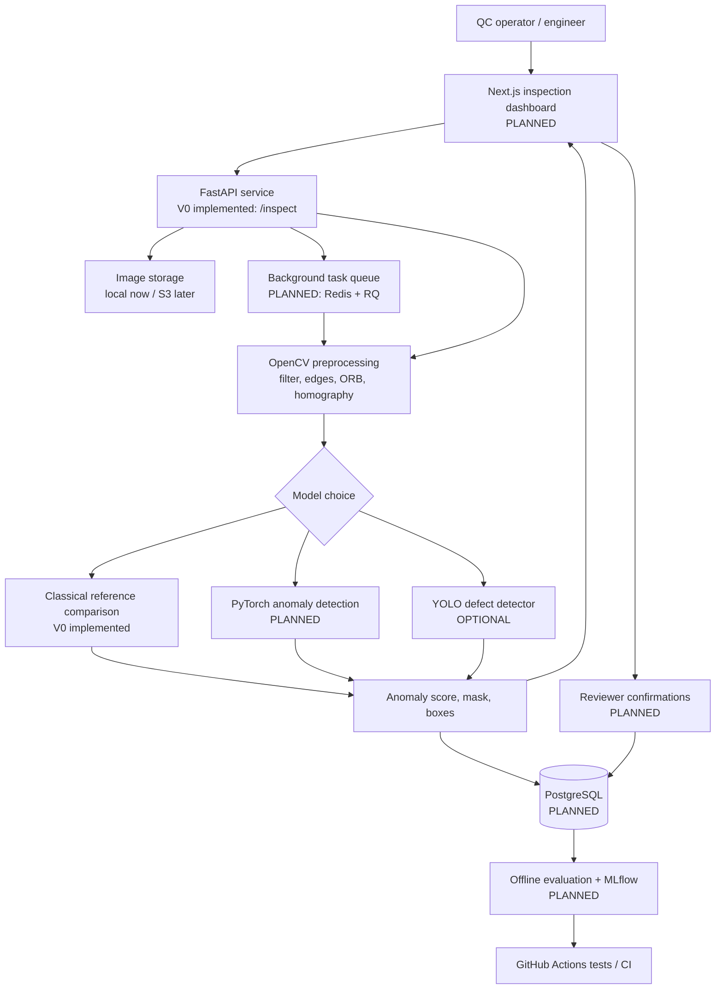

# InspectAI — PCB Defect Detection & Visual Inspection Platform

> **Status: scaffold + working CPU classical-CV baseline.** Neural models, database, UI, and deployment are planned milestones, **not implemented yet**.

A course-aligned, startup-oriented computer vision engineering project. **Product hypothesis:** small electronics manufacturers need an affordable, quickly configurable inspection system that flags unusual PCB regions even when very few defective samples are available. Validate this hypothesis with potential customers before investing in hardware or commercial pilots.

**Course:** Imperial College London COMP70089 Computer Vision — https://www.imperial.ac.uk/computing/current-students/courses/70089/  
**Dataset:** Amazon Science VisA — https://github.com/amazon-science/spot-diff  
**GPU:** none needed for baseline/API; cloud GPU useful for training CNN/YOLO and benchmarking heavier anomaly models.

## Contents
1. [Product and customer problem](#product-and-customer-problem)
2. [Scope and success metrics](#scope-and-success-metrics)
3. [End-to-end architecture](#end-to-end-architecture)
4. [Mapping to Imperial's CV course](#mapping-to-imperials-cv-course)
5. [Data and labelling strategy](#data-and-labelling-strategy)
6. [Computer vision learning path](#computer-vision-learning-path)
7. [Detailed 12-week roadmap](#detailed-12-week-roadmap)
8. [Evaluation and experiment design](#evaluation-and-experiment-design)
9. [Technology decisions](#technology-decisions)
10. [Run the existing starter](#run-the-existing-starter)
11. [Repository layout](#repository-layout)
12. [Startup validation](#startup-validation)
13. [Resources and attribution](#resources-and-attribution)

## Product and customer problem

**Customer:** begin with small electronics manufacturers and prototype-assembly shops, especially those changing board designs frequently. **User:** quality-control operator / production engineer. **Buyer:** operations / quality manager.

**Problem hypothesis:** Traditional inspection may require difficult configuration or extensive labelled defect examples. A low-data software-first inspector might reduce time spent configuring and reviewing inspections. Existing AOI vendors are sophisticated; this is **not** a claim the market is unserved. Interview actual operators to determine whether the pain is urgent and whether a camera/software-only solution would be trustworthy.

**User workflow:** operator selects PCB design → uploads a golden/reference image plus board image → system aligns and checks it → gets heatmap and flagged regions → confirms/rejects anomalies → exports report. Later: set up a new product using normal-only examples, run inspections from a camera/video stream, and learn from reviewed examples.

**What is not promised:** The prototype is **not** a production-certified electrical safety or quality-assurance system. It cannot guarantee detection of internal electrical faults and must not automatically approve boards for shipment without adequate validation.

## Scope and success metrics

**V0 (implemented scaffold):** CPU image comparison after optional ORB-based alignment; Gaussian smoothing, absolute difference, thresholding, morphology, bounding boxes; FastAPI endpoint and local CLI. Suitable for roughly aligned images of the **same PCB design**. It is intentionally a naive baseline and can have many false positives with lighting, pose, or manufacturing variations.

**V1 (planned):** rigorous classical CV benchmark, repeatable train/validation/test splits, calibrated decision thresholds, labelled dataset evaluation, reviewer interface.

**V2 (planned):** pretrained CNN transfer learning and normal-only anomaly model (e.g. PaDiM/PatchCore), heatmap localization. Compare against V0.

**V3 (planned):** YOLO detection only if dataset has appropriate box-level *defect-type* labels; use segmentation masks to derive boxes when justified, documenting their limitations. Do not assume the VisA dataset provides YOLO-ready class labels.

**V4 (planned):** production-like API, async job queue, SQL persistence, object store, containerization, metrics, tests, deployment, video and 3D extensions as optional work.

**Evidence of success:** image-level AUROC / average precision; recall at a target false-positive rate; pixel AUROC and region-based localization metrics where masks are available; inference p50/p95 latency; time to configure for a new board; actual operator review time. Report each board subset independently and aggregate carefully. **No accuracy figures are claimed yet.**

## End-to-end architecture



**Important implementation note:** The current API returns JSON with an anomaly score and boxes; it does not yet store results, run background jobs, or display a dashboard. The heavy components in the diagram are the **target system**. `docs/architecture.md` includes request flow and data model.

## Mapping to Imperial's CV course

Official syllabus: image filtering; edge and interest point detection; feature descriptors; image classification; object detection and image segmentation; neural networks; motion estimation; 3D vision.

| Course content | Learning task | Concrete output | How to verify |
|---|---|---|---|
| Image formation / pixels | Understand lighting, exposure and RGB/greyscale | capture assumptions and image quality checks | test under varied brightness |
| Image filtering | Implement Gaussian blur and median filtering | reproducible preprocessing pipeline | noise ablation |
| Edge detection | Canny + threshold morphology | edge maps and binary masks | visualize sensitivity to parameters |
| Interest points | ORB (then SIFT) keypoints | keypoint visualization | inliers and match counts |
| Feature descriptors | BFMatcher + ratio test | aligned board-to-reference images | corner reprojection error / failed registrations |
| Geometric transforms / 3D projection | Homography, pixel/world mapping | planar alignment; optional camera calibration | overlay residuals and calibration error |
| Image classification | Logistic regression on HOG; small CNN | normal/defective model | held-out AUROC and precision/recall |
| Neural networks | Transfer-learning ResNet18/MobileNet | deep baseline | compare to HOG and classical CV |
| Object detection | YOLO only with suitable labels | boxes and confidences | mAP and recall at FP budget |
| Segmentation | threshold masks; later PatchCore/PaDiM masks | anomaly heatmaps | pixel-AUROC and region metrics |
| Motion estimation | Lucas–Kanade optical flow | optional moving-line demo | tracks across frames |
| Object tracking | simple centroid/IoU association | optional per-board inspection histories | ID switches, processing delay |
| 3D vision | camera calibration + optional stereo/depth | optional raised-component inspection | reprojection / depth error |

**Academic integrity:** This project is independent study. Do not upload Imperial's restricted lecture materials or assessed coursework solutions. Use course concepts, your own notes, and permitted resources.

## Data and labelling strategy

**Begin with VisA `pcb1` and expand to `pcb2`–`pcb4`.** VisA includes normal and anomalous images and pixel-level masks. Original source lists four PCB subsets and defines train-normal, test-normal, test-anomaly and ground-truth masks in prepared one-class setups. Dataset is **CC BY 4.0** with attribution; verify additional conditions if publishing commercial derivatives. Do **not** commit the full dataset to Git.

1. Download from Amazon Science's official repository and run their published split preparation utility or explicitly reproduce the split yourself.
2. Inspect `image_anno.csv` and verify image/mask dimensions and file names; create `manifest.csv` with `path,split,category,is_anomaly,mask_path,board_id`.
3. Keep test images sealed until final evaluation. Use a validation subset for thresholds and hyperparameters. Avoid near-duplicate or adjacent images leaking across splits.
4. VisA contains anomaly category annotations, but do not equate them with your desired manufacturing taxonomy; review examples before promising classes like “solder defect”.
5. For reference alignment, select matching images of the *same PCB type/pose*. Not all images have an unambiguous golden counterpart.
6. For the startup, seek permission to collect camera images and operator feedback from a real production environment. Check data rights and confidentiality.

## Computer vision learning path

**Start small, understand the math, and benchmark before adding pretrained models.**

### Phase A — classical CV (CPU)
- Learn image coordinates, filtering and convolution, Canny edges, morphological operations.
- Detect ORB keypoints on reference and candidate PCBs; match descriptors and estimate planar homography with RANSAC.
- Warp image, compute abs-difference or structural similarity, threshold, remove noisy blobs, output boxes and heatmap.
- Failure cases: specular highlights, colour/lighting, perspective, missing keypoints, alignment error. When homography fails, do **not** silently claim the image passed inspection.
- Baselines: no alignment; ORB alignment + abs difference; optional SSIM. Visualize all cases.

### Phase B — image classification (CPU first, GPU when feasible)
- HOG features + scikit-learn logistic regression/SVM.
- CNN from scratch on tiny toy images (learning exercise, **not** competitive benchmark).
- Pretrained MobileNetV3 or ResNet18 embeddings + linear classifier; optional fine-tuning in Colab/Imperial subject to access rules.
- Evaluate per-board subset with class imbalance, errors, and confidence calibration.

### Phase C — anomaly localization (cloud GPU optional)
- Study one-class learning: fit models mostly or exclusively on normal samples.
- Explore PaDiM or PatchCore through Anomalib (https://anomalib.readthedocs.io/).
- Compare image-level anomaly score and spatial anomaly maps with classical baseline. Control for image resolution and compute budget.
- Threshold on validation **only**; quantify trade-offs between missed defects and false alarms.

### Phase D — object detection (optional, for learning YOLO)
- Learn bounding boxes, IoU, non-max suppression and mAP.
- Prepare a *labelled defect detection* subset (possibly boxes derived from pixel masks, with clear category mapping limitations).
- Fine-tune a small Ultralytics YOLO model using cloud GPU. Compare YOLO against normal-only anomaly localization: YOLO is designed to detect known trained classes, while anomalies may be unseen.
- Check each model's licence before commercialization.

### Phase E — engineering + user workflow
- API: job submission, board design/version, image upload, inspect, results, human overrides.
- Store image files in S3-compatible storage, metadata and labels in PostgreSQL, async work in Redis/RQ.
- Minimal Next.js dashboard: upload, reference selection, mask overlay, reviewer correction, downloadable PDF/CSV report.
- Containerize API and workers; GitHub Actions tests; log inference duration and failed alignment. Restrict uploads, validate types/sizes, and secure storage/auth.

## Detailed 12-week roadmap

| Week | Study / implementation | Deliverable | Completion gate |
|---|---|---|---|
| 1 | Understand PCB workflow, VisA labels, filters and Canny | data card + image exploration | 20 samples visually checked and split documented |
| 2 | ORB, descriptors, matching, RANSAC homography | classical alignment baseline | alignment success/failure visibly labelled |
| 3 | Difference masks, thresholds, morphology; annotate false positives | reproducible CPU inspection CLI | documented baseline error analysis |
| 4 | HOG + logistic regression/SVM | classifier notebook/script | validation metrics and error samples |
| 5 | CNN basics + pretrained backbone | PyTorch classifier | reproducible train/eval and saved checkpoint |
| 6 | One-class anomaly localization | PatchCore or PaDiM baseline | image-level and mask-based metrics |
| 7 | Compare methods, ablate preprocessing / thresholds | evaluation report | fixed held-out test metrics, no leakage |
| 8 | Learn YOLO fundamentals and train optional known-defect detector | detection comparison | mAP/recall on valid labels or documented skip |
| 9 | Add APIs, DB schema and background workers | multi-image processing backend | integration tests for upload and results |
| 10 | Build dashboard and reviewer feedback | product demo | users can inspect and correct output |
| 11 | Docker, deployment, monitoring, security basics | reproducible service | health checks, CI and latency benchmark |
| 12 | user testing and documentation | demo, architecture, model card, case study | measured usability + technical results |

**Priorities when busy:** complete weeks 1–3 and a tested API first; then weeks 4–7; only add video/YOLO/3D after completing a sound benchmark. Estimates are planning targets, not guarantees.

## Evaluation and experiment design

**Research questions:**
1. Does alignment materially reduce false alarms compared to naive image differencing?
2. How do classical CV, HOG-based classification, and pretrained anomaly detection perform as the normal-training set shrinks (e.g. 5, 20, 100 normal images)?
3. How robust is each model to new lighting, rotation, PCB design and camera setup?
4. Can a human-in-the-loop workflow speed up inspection without hiding hard cases?

**Metrics:**
- Image-level: AUROC, average precision; precision/recall/F1 at a validation-selected threshold; confusion matrix.
- Localization: pixel AUROC and a region-based metric (e.g. AU-PRO) where GT masks exist; qualitative false-positive heatmaps.
- Runtime: p50/p95 inference latency, CPU memory, throughput and cost per image.
- Product: time to onboard a new design, human-review time, defect escape rate (only after real-world validation), false alarms per 100 inspected boards.

**Baselines:** always report naive diff, aligned diff, linear image classifier, deep classification, and one-class anomaly method only if actually implemented. Measure on held-out data; do not make up metrics. Use a single evaluation script and record configs, versions, seeds and hashes.

## Technology decisions

| Layer | Version 0 (present) | Target architecture (planned) |
|---|---|---|
| Language | Python 3.11+ | Python |
| Classical CV | OpenCV + NumPy | OpenCV |
| ML/CV | none yet | scikit-learn, PyTorch, Anomalib, optional YOLO |
| API | FastAPI | FastAPI + auth + background tasks |
| Frontend | interactive API docs | Next.js/TypeScript |
| DB | none | PostgreSQL |
| File storage | local filesystem / request | S3-compatible object storage |
| Queue | none | Redis + RQ |
| Tracking | simple logs | MLflow + structured logging |
| Infrastructure | local Uvicorn | Docker, managed deployment |
| CI | pytest via GitHub Actions | tests, lint, model checks |

## Run the existing starter

```bash
# From repository root, Python 3.11+
python -m venv .venv
# Linux/macOS:
source .venv/bin/activate
# Windows PowerShell:
# .venv\Scripts\Activate.ps1
pip install -e '.[dev]'
pytest
python scripts_make_demo.py
python -m inspectai.cli --reference demo/reference.png --candidate demo/candidate.png --output demo/result.png
uvicorn inspectai.api:app --reload
```

Try the browser at `http://127.0.0.1:8000/docs` and POST `/inspect` with `reference` and `candidate` images. Or run:

```bash
curl -X POST http://127.0.0.1:8000/inspect -F "reference=@demo/reference.png" -F "candidate=@demo/candidate.png"
```

Example response fields: `anomaly_score` (fraction of foreground pixels, **not a calibrated probability**), `boxes`, `alignment_succeeded`, `warning`. The synthetic demo includes a conspicuous synthetic “missing component” region; **results on real PCBs are not guaranteed**.

### Baseline limitations
- Different board revisions or viewpoints can invalidate comparison.
- Threshold and contours are hand-tuned placeholders, not calibrated to industrial false-positive constraints.
- ORB is optional and fallback unaligned comparison is explicitly flagged.
- No authentication, persistence, UI, dataset integration, retraining, or production hardening is present in V0.

## Repository layout

```text
inspectai-pcb-vision/
├── README.md
├── docs/
│   ├── architecture.md
│   ├── experiments.md
│   └── startup-validation.md
├── src/inspectai/
│   ├── api.py
│   ├── cli.py
│   └── classical.py
├── tests/
│   ├── test_classical.py
│   └── test_api.py
├── scripts_make_demo.py
├── pyproject.toml
├── .github/workflows/tests.yml
├── .gitignore
└── data/  # local dataset only; not checked in
```

## Startup validation

Interview 10–15 PCB assembly quality/production staff before building production integrations. Ask for concrete examples of recent inspection problems, changeover times, cost of false rejects and escapes, tooling used, budget, and constraints. Test one permitted batch of real images against their current process. Do not treat a working benchmark on VisA as product-market fit. See [`docs/startup-validation.md`](docs/startup-validation.md).

## Resources and attribution

- Imperial COMP70089 Computer Vision: https://www.imperial.ac.uk/computing/current-students/courses/70089/
- Amazon Science VisA dataset: https://github.com/amazon-science/spot-diff (dataset CC BY 4.0; cite Zou et al., *SPot-the-Difference*, ECCV 2022)
- OpenCV tutorials: https://docs.opencv.org/4.x/d9/df8/tutorial_root.html
- PyTorch tutorials: https://pytorch.org/tutorials/
- Anomalib docs: https://anomalib.readthedocs.io/
- Ultralytics documentation: https://docs.ultralytics.com/ (check applicable licence for any commercial use)
- FastAPI: https://fastapi.tiangolo.com/
- scikit-learn: https://scikit-learn.org/stable/

## Licence

This new repository scaffold is supplied for your use. Third-party datasets, models, and dependencies retain their own licences. Choose an explicit repository licence before public release.
